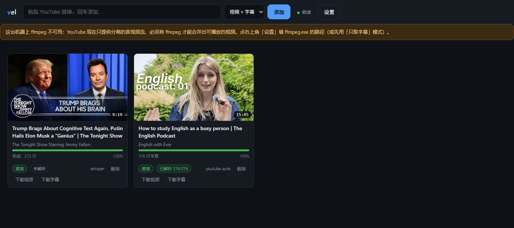
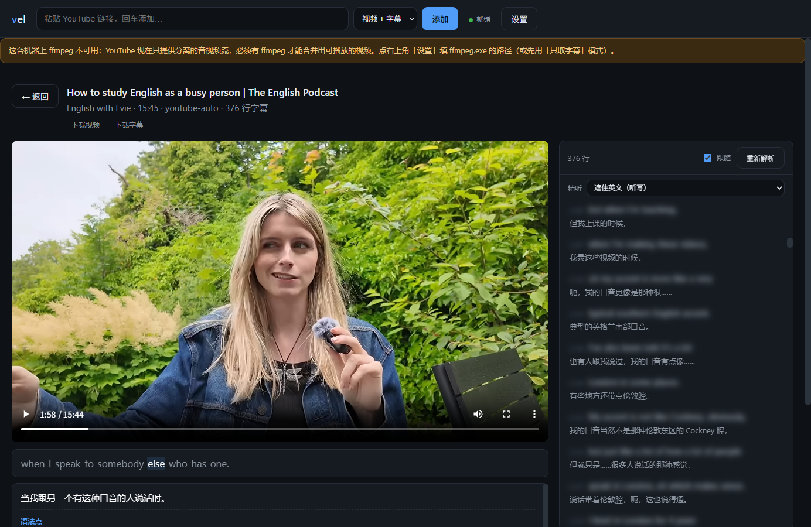
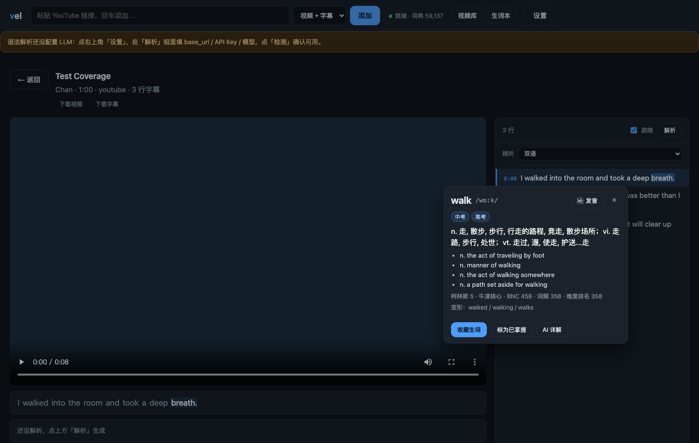
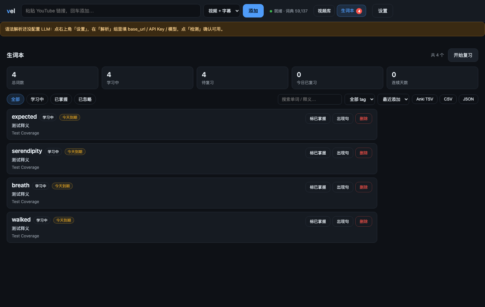

# VideoEnglishLearner（`vel`）

一个跑在自己电脑上的英语学习播放器：贴一个 YouTube 链接，它把视频和英文字幕拉到本地，
切成适合精读的字幕行，配一个同步滚动、点一下就跳转的播放器；配上大模型后，还能逐句给你
中文翻译、重点语法和短语讲解。字幕里点任意单词就能查词、收藏进生词本，按 FSRS 间隔复习，
还能看到每集视频的词汇覆盖率。

用来做 vlog / 播客 / 访谈的精听和精读，不需要把视频传到任何云端；查词和单词复习完全离线，
只有「AI 详解」和逐句解析会调你自己配置的大模型。









## 它做什么

- **贴链接就行**：YouTube 视频 + 英文字幕一次拿到本地；也可以「只取字幕」或「只取视频」，分开下载
- **跟得上的播放器**：字幕同步滚动、点字幕跳到对应时间、逐词高亮、AB 复读、0.75 倍速、断点续看
- **精听三档**：双语 / 遮住英文听写 / 只看英文，点一下就揭示
- **点词查词**：字幕里点词弹出词典卡——音标、中英释义、词形变化，以及中考 / 高考 / 四级 / 六级 /
  考研 / 托福 / 雅思 / GRE 考试标签；点「发音」用系统语音朗读，不联网
- **生词本 + 间隔复习**：一键收藏（自动带上来源视频和原句）或标为已掌握；复习时把来源句里的
  目标词挖空，回忆后按 1–4 评分，FSRS 排程算出下次到期时间；顶栏有「待复习」徽标
- **词汇覆盖率**：每集算出认识的词占比（词频前 2000 视为已知 + 生词本里标为已掌握的词），
  生词按出现次数排序，方便决定这集值不值得精听
- **导出**：生词本可导出 Anki TSV（带 Anki 专用头，可直接导入）/ CSV / JSON；视频和 SRT 也能下载
- **「AI 详解」可选**：查词卡上点一下，让大模型结合当前句给语境义、搭配和语法角色，按
  「单词 + 句子」缓存，同一个词反复点不重复花钱
- **逐句解析**：中文翻译 + 重点语法（点到为止，只挑真有用的）+ 短语和语气说明，结果按句缓存
- **处理进度看得见**：卡片上有进度条，处理中顶部有任务条
- **没有字幕也能用**：视频确实没字幕时，用本地 faster-whisper 转写（CPU 能跑，有 N 卡更快）
- **导出**：下载视频、下载字幕（SRT）
- **所有设置都在网页里**：ffmpeg 路径、代理、字幕来源、切分参数、大模型，都有表单和「检测」按钮

## 技术（简述）

- **后端**：Python 3.11+ / FastAPI + Uvicorn，SQLite 存库；任务用进程内单个 worker 串行跑，
  个人使用够用，不需要 Redis / Celery
- **下载**：yt-dlp + ffmpeg
- **字幕**：优先 YouTube 官方 / 自动字幕（自带词级时间戳）；视频确实没有字幕时才用
  faster-whisper（CTranslate2）本地转写
- **切行**：词级时间戳 + 动态规划，按行长、时长、标点、行首虚词打分取最优切法；纯规则，不调模型
  （以后接 LLM 只换代价函数）
- **前端**：单页原生 HTML/CSS/JS，没有构建步骤；播放用原生 `<video>`，后端支持 HTTP Range，所以 seek 很快
- **大模型**：OpenAI 兼容接口（标准库 urllib 实现），DeepSeek、本地 Ollama、任何兼容端点都能用；
  按批请求、按句缓存，重复解析不重复花钱
- **词典**：ECDICT（MIT，英汉双解）裁剪成 SQLite——默认保留 BNC/当代语料前 6 万词条 + 考试大纲词
  + 词形变化表，约 14MB、5.9 万词条；查询是纯本地 SQLite，毫秒级，零网络零费用
- **复习**：自己实现的 FSRS-4.5 排程（stability / difficulty / 遗忘曲线），按评分算下次间隔，
  不依赖 Anki 或任何外部服务

## 怎么运行

### 需要什么

| 需要 | 说明 |
| --- | --- |
| Python 3.11+ | 3.14 也验证过 |
| ffmpeg | **硬依赖**。YouTube 现在只提供分离的音视频流，没它合不出能播的文件 |
| 本地词典 | 可选。在「设置 → 词典」里一键下载（约 63MB 源文件 → 14MB SQLite）；不装也能播放、解析 |
| 代理（国内） | 访问 YouTube 要用，填在 `config.toml` 或网页「设置 → 网络」里 |

### 跑起来

```bat
git clone https://github.com/JasonLe/VideoEnglishLearner.git
cd VideoEnglishLearner
python -m venv .venv
.venv\Scripts\python -m pip install -r requirements.txt
```

先填代理（也可以直接跳到网页「设置」里填，效果一样）。把示例配置复制一份再改：

```bat
copy config.example.toml config.toml
```

```toml
# config.toml
[network]
proxy = "http://127.0.0.1:7890"
```

`config.toml` 里会有你的代理地址和 API Key，所以它不进 Git（已在 `.gitignore` 里）。

然后启动：

```bat
run.bat
```

或者手动 `.venv\Scripts\python -m app.cli serve`，打开 <http://127.0.0.1:8787>。

ffmpeg 如果不在 PATH 里，第一次打开网页会看到顶部提示，点「设置 → 下载」填 `ffmpeg.exe`
的路径，点「检测」确认能用。

### 可选：本地转写

视频真的没有字幕时会走这条路。

```bat
:: CPU（约 150MB 依赖，够用）
.venv\Scripts\python -m pip install -r requirements-asr.txt

:: NVIDIA 显卡（另外要装 CUDA 12 运行库的 wheel，见 requirements-asr-gpu.txt）
.venv\Scripts\python -m pip install -r requirements-asr-gpu.txt
```

模型默认缓存在 `data/models`，国内建议先设镜像：`set HF_ENDPOINT=https://hf-mirror.com`。

### 可选：接大模型做解析

网页「设置 → 解析」里填：

- DeepSeek：`https://api.deepseek.com/v1` + 你的 API Key + `deepseek-chat`
- 本地 Ollama：`http://localhost:11434/v1` + 任意 Key（本地不校验）+ 模型名，比如 `qwen2.5:7b`

填完点「检测」确认通，再回播放页点「解析」。不填也能用——只是没有翻译和语法讲解。

## 怎么用

1. 把 YouTube 链接粘进顶部输入框，选模式（视频 + 字幕 / 只取字幕 / 只取视频），点「添加」
2. 等处理完：卡片上有进度条，处理中顶部会显示当前任务
3. 点卡片进播放器，点字幕跳转、点词看高亮
4. 想精听就切「精听」下拉框到「遮住英文（听写）」，卡住时点那一行揭示
5. 想看懂就点右上「解析」（需要先配好大模型），右侧面板按句给译文 / 语法 / 短语
6. **字幕里点任意单词**：弹出查词卡，可以「收藏生词」（学习中有虚线下划线）、「标为已掌握」；
   点「AI 详解」结合当前句讲解（需要先配大模型）
7. **顶栏「生词本」**：按状态 / 考试标签 / 搜索筛选，展开「出现句」会列出所有视频里的原句，
   点一句直接跳回播放器对应位置；「开始复习」进入挖空复习，空格揭示、1–4 评分
8. 卡片和播放页都有「下载视频」「下载字幕」；生词本有 Anki TSV / CSV / JSON 导出

### 下载本地词典

「设置 → 词典」里点「下载并构建」：会下载 ECDICT 的 `ecdict.csv`（约 63MB，MIT 协议）并裁剪成
`data/dict/ecdic.db`（约 14MB）。已安装的卡上能看到词条数、词形数、体积和构建时间，也可以
「重建」（改档位后）或「删除」。

不想在网页里等也可以命令行跑：

```bat
.venv\Scripts\python tools\build_dict.py --download --force
```

词典服务端下载走 `[network] proxy`；GitHub 直连慢的话，可以在设置里把「词库源地址」换成镜像。

### 快捷键

| 键 | 作用 |
| --- | --- |
| `空格` | 播放 / 暂停（播放页里始终生效，焦点停在输入框或下拉里也一样） |
| `←` `→` | 后退 / 前进 3 秒 |
| `↑` `↓` | 上一句 / 下一句 |
| `Enter` | 复读当前句 |
| `A` / `B` | 设 AB 复读点 |
| `R` | 循环当前选区 / 清除 |
| `S` | 1.0 ↔ 0.75 倍速 |
| `N` | 切换精听三档 |
| `Esc` | 一键退出 AB 循环 / 单句复读 / 0.75 倍速（回到 1.0×）；也关查词卡 / 复习弹窗 |

生词本复习弹窗打开时：`空格` 显示答案，`1` `2` `3` `4` = 忘了 / 模糊 / 记得 / 熟练，`Esc` 关闭。

## 常见问题

- **顶部提示「ffmpeg 不可用」/ 下载后没声音**：ffmpeg 没装或路径没配，去设置页填路径后点「检测」
- **字幕下载报 429 / Too Many Requests**：YouTube 限流，等 2–5 分钟点「补字幕」就行；
  或者用浏览器插件导出 `cookies.txt`，填进设置页「网络 → cookies 文件」
- **解析报 401 / 402 / 404 / 429**：分别是 Key 不对、余额不足、base_url 或模型名不对、被限流
- **有 N 卡但转写很慢**：日志里如果出现「显卡缺 CUDA 运行库，改用 CPU」，装
  `requirements-asr-gpu.txt` 里的依赖即可
- **查词弹窗提示「词典还没有安装」**：去「设置 → 词典」点「下载并构建」，或者命令行
  `tools/build_dict.py --download --force`；只影响查词 / 覆盖率 / 生词本里的词典信息，
  播放和解析不受影响
- **词典下载失败 / 很慢**：默认从 GitHub raw 拉 63MB，国内容易超时；改「设置 → 词典 → 词库源地址」
  为镜像地址，或手动下载 `ecdict.csv`、`lemma.en.txt` 后用 `tools/build_dict.py` 离线构建
- **数据在哪**：全在 `data/` 下（`vel.db` 数据库、`media/` 视频、`*.srt` 字幕、`models/` 模型缓存、
  `dict/ecdic.db` 词典）；想搬到别的机器，把整个 `data/` 复制过去就行

## 合规

自己学习用：只存本地、不公开分发、不批量搬运。下载功能请遵守 YouTube 服务条款和当地版权规定。
